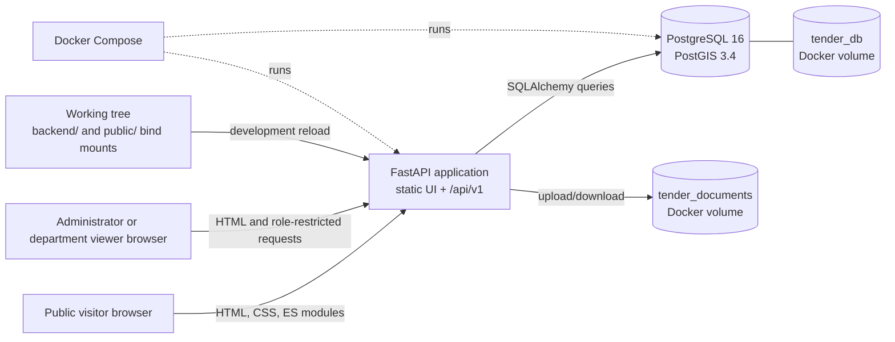
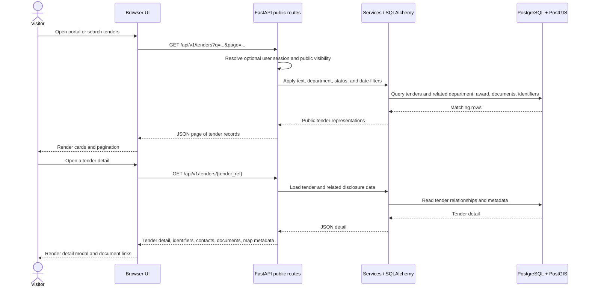
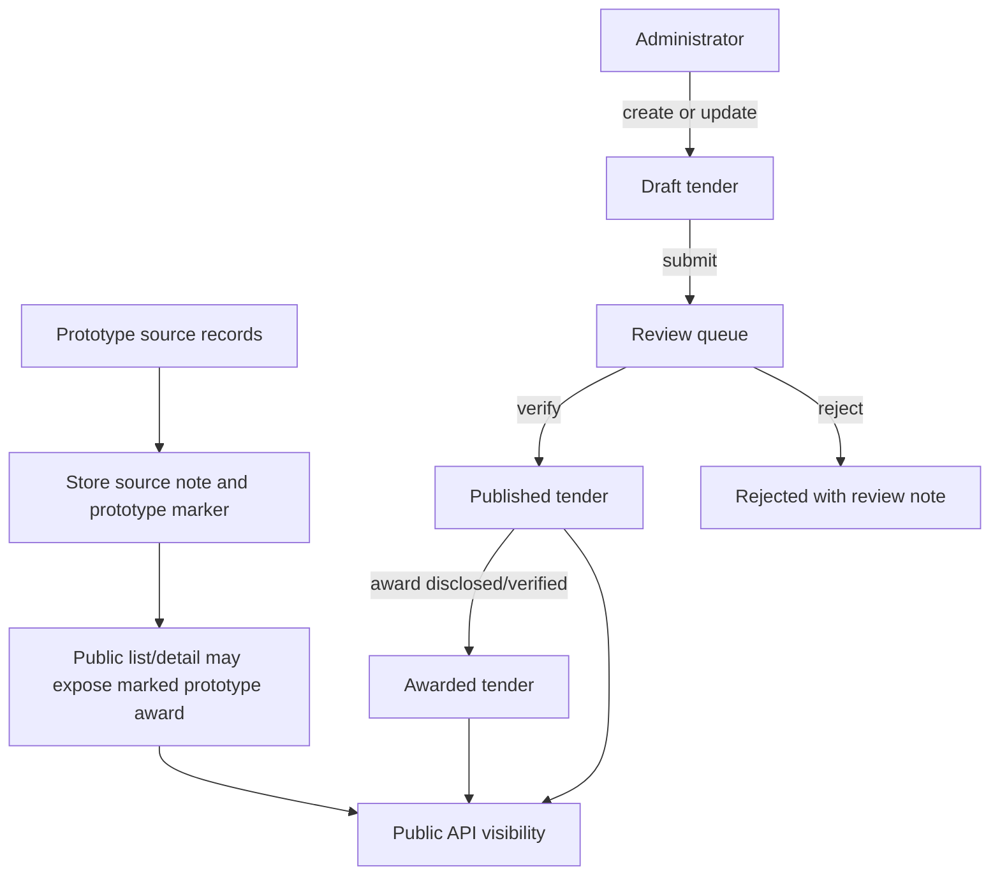

# Road Sathi Technical Design

**Status:** Implementation-oriented design for the repository's current Docker Compose application. This document describes the checked-in code and data flow; it is not a production deployment guarantee.

## 1. Purpose and scope

Road Sathi publishes tender and public-works records through a browser portal and JSON API. The current application supports public search and disclosure, tender documents and route data, an administrative review workflow, and department-scoped viewer endpoints. The supplied prototype records are identified as coming from working notes and include provisional award information.

The service is designed as a single-origin local deployment: FastAPI serves both the static browser application and `/api/v1` endpoints. PostgreSQL with PostGIS stores procurement entities and geographic features. Docker Compose provides the API and database containers.

## 2. Technology and runtime components

| Area | Current implementation |
|---|---|
| Browser UI | Static HTML, CSS, and vanilla JavaScript ES modules under `public/` |
| API | Python 3.12, FastAPI, Pydantic settings, SQLAlchemy ORM |
| Database | PostgreSQL 16 with PostGIS 3.4 |
| Geospatial data | PostGIS geography/geometry and GeoJSON responses |
| Authentication | Signed short-lived access tokens, refresh tokens, HttpOnly cookie support, password hashing, role checks |
| Documents | Files under the upload directory, metadata and tender relation in PostgreSQL |
| Local runtime | Docker Compose; backend and public UI are bind-mounted for reload |

## 3. Deployment architecture



The development Compose file publishes the web/API on port `8000` and PostgreSQL on port `5432`. The API waits for the database health check before startup. PostgreSQL data and uploaded files use separate named volumes. The Compose `--reload` command and bind mounts are development conveniences and should not be used as a production deployment plan.

## 4. Main request flow



Static assets and API responses share the FastAPI origin. The browser does not connect directly to PostgreSQL; all reads and writes go through the API.

## 5. Procurement data model

```mermaid
erDiagram
    DEPARTMENT ||--o{ TENDER : owns
    DEPARTMENT ||--o{ OFFICER : lists
    TENDER ||--o| TENDER_IDENTIFIER : identifies
    TENDER ||--o| AWARD : discloses
    CONTRACTOR ||--o{ AWARD : receives
    TENDER ||--o{ TENDER_DOCUMENT : supports
    TENDER ||--o{ TENDER_SPATIAL_FEATURE : maps
    CONTRACTOR ||--o{ CONTRACTOR_CONTACT : publishes
    USER ||--o{ REFRESH_TOKEN : receives
    USER ||--o{ AUDIT_LOG : performs

    DEPARTMENT {
        int id PK
        string name UK
        string district
    }
    TENDER {
        int id PK
        string tender_ref UK
        int department_id FK
        string title
        json extra_data
        string status
    }
    TENDER_IDENTIFIER {
        int id PK
        int tender_id FK_UK
        string tender_identifier
        string reference_number
    }
    AWARD {
        int id PK
        int tender_id FK_UK
        int contractor_id FK
        numeric awarded_value
        string status
    }
    TENDER_DOCUMENT {
        int id PK
        int tender_id FK
        string document_type
        string storage_name UK
    }
    TENDER_SPATIAL_FEATURE {
        int id PK
        int tender_id FK
        string source_filename
        string feature_name
        geography geometry
    }
    CONTRACTOR {
        int id PK
        string company_name
        string registration_no
    }
    CONTRACTOR_CONTACT {
        int id PK
        int contractor_id FK
        string name
        string role
    }
    OFFICER {
        int id PK
        int department_id FK
        string name
        string designation
    }
    USER {
        int id PK
        string email UK
        string role
        int department_id FK
        boolean is_active
    }
    REFRESH_TOKEN {
        int id PK
        int user_id FK
        string token_hash UK
        datetime expires_at
    }
    AUDIT_LOG {
        int id PK
        int user_id FK
        string action
        string table_name
        int record_id
    }
```

`TenderIdentifier` is a one-to-one child of `Tender`: its unique `tender_id` foreign key cascades on tender deletion. It stores the source tender ID and procurement reference number separately from the application's internal integer primary key and API `tender_ref`. A tender may have multiple document and spatial-feature rows, while award is one-to-one in the current schema. `extra_data` remains available for additive metadata; credentials and secrets must not be placed there.

The prototype seed loader reads `backend/app/prototype_data.json` and `backend/app/prototype_geodata.json`. It inserts missing prototype records and their relations idempotently. Startup with `LOAD_PROTOTYPE_DATA=false` stops future seeding; it does not delete previously imported records.

## 6. Publication and access flow



Public routes expose published and awarded tenders. Administrators have management and review endpoints. Department viewers are scoped to their department by the viewer routes. Authentication accepts bearer tokens and supports an HttpOnly cookie; refresh tokens are stored as hashes and logout increments the user's token version and revokes active refresh tokens. Prototype awards are a deliberate exception to the usual verified-award visibility rule and are exposed with provisional/source metadata, so consumers should preserve that status in downstream displays.

## 7. API boundaries

- **Public reads:** `/api/v1/health`, `/stats`, `/activity`, `/departments`, `/tenders`, `/tenders/{ref}`, `/tenders/map`, `/tenders/nearby`, and tender document routes.
- **Authentication:** `/api/v1/auth/login`, `/refresh`, `/logout`, and `/me`.
- **Administration:** `/api/v1/admin/*` for review, tender and award updates, users, department entities, audit records, and CSV import; requires administrator role.
- **Department viewer:** `/api/v1/viewer/*` for department-scoped information; requires authentication and uses the user's department scope.

The generated OpenAPI schema at `/docs` is the runtime API reference. Public serialization is centralized in `backend/app/services.py` so tender list/detail responses share their representation.

## 8. Files and geospatial flow

Document metadata is stored in `tender_documents`; uploaded file bytes are resolved under `UPLOAD_DIR` and path-checked before download. Compose mounts that path to `tender_documents`. KMZ sources are linked to tenders as documents, and imported route features are stored in PostGIS with a tender foreign key. Map responses use simplified GeoJSON for display; stored geometry remains available for spatial querying. The original supplied files remain separate source artifacts.

## 9. Configuration and operations

Configuration comes from Pydantic settings and the Compose environment. See the environment-variable table in the root README. Compose constructs `DATABASE_URL` from `POSTGRES_DB`, `POSTGRES_USER`, and `POSTGRES_PASSWORD`; the API uses `UPLOAD_DIR` for stored files.

`initialize_database()` enables PostGIS, calls SQLAlchemy `create_all()` to create missing tables, and applies a few compatibility `ALTER TABLE` statements. This is not a versioned migration system. Before production schema changes, introduce and review a migration workflow. Back up the database volume and document volume together and test restore procedures.

## 10. Verification and current limitations

`backend/tests/verify_all.py` is an HTTP integration verification script covering health/auth, token refresh, admin tender operations, role separation, public visibility, map response shape, CSV validation/import, and logout revocation. It uses fixed local administrator credentials and writes rows; run it only against a disposable local database as described in the README. The repository also contains sample tender and route data; this document does not replace or modify that data.

The Compose configuration is aimed at local development. Production operation still requires a hardened secret-management and HTTPS setup, restricted origins, persistent protected file storage, rate limiting, backups, and versioned database migrations. Prototype values and third-party source documents must retain their provenance and applicable rights.